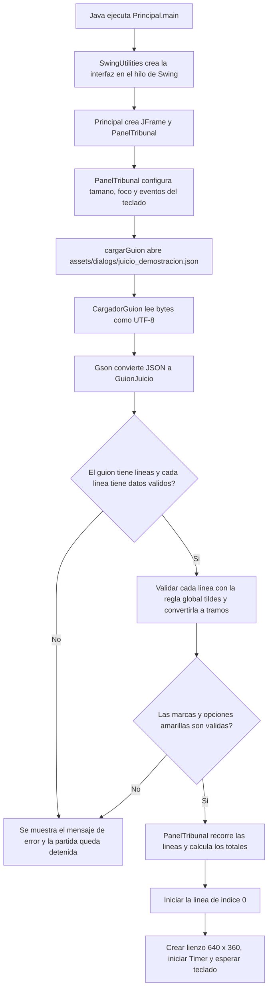
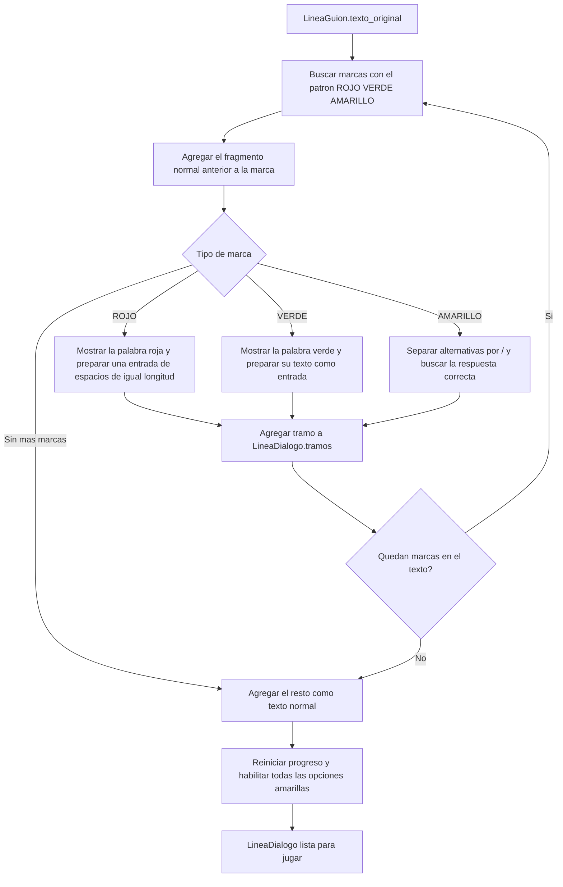
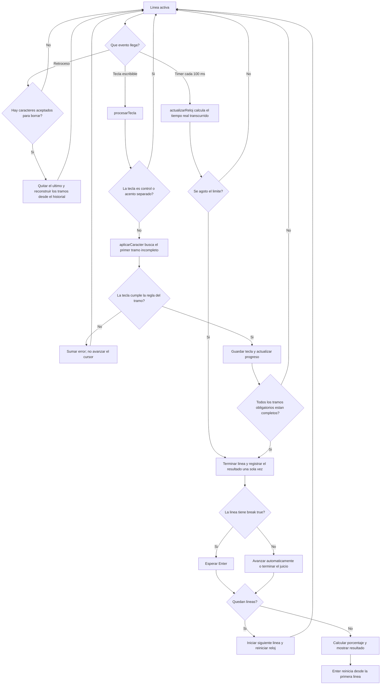
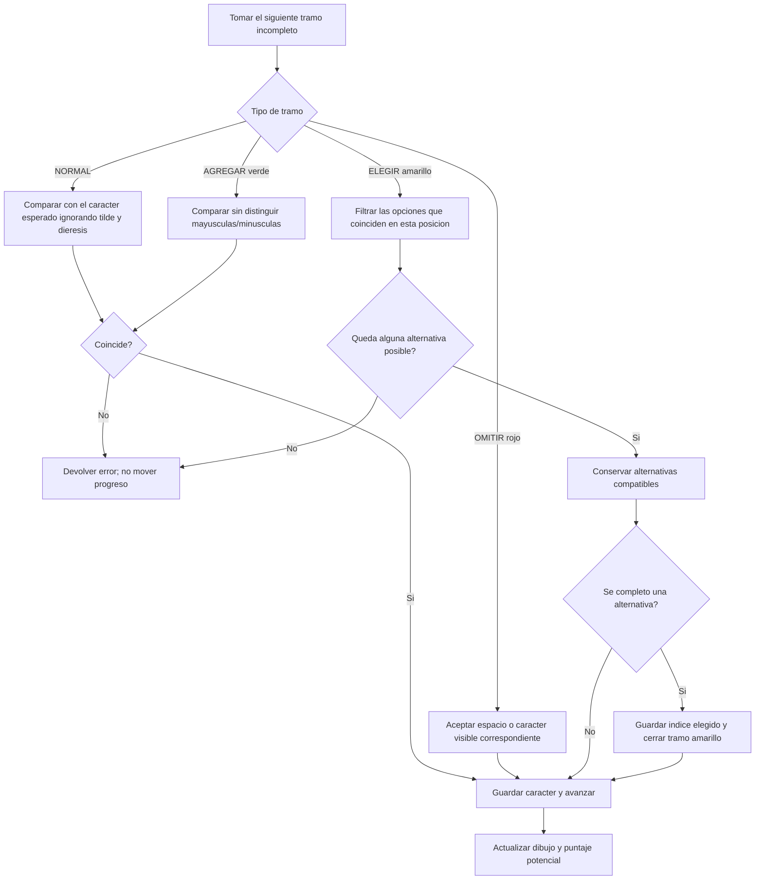
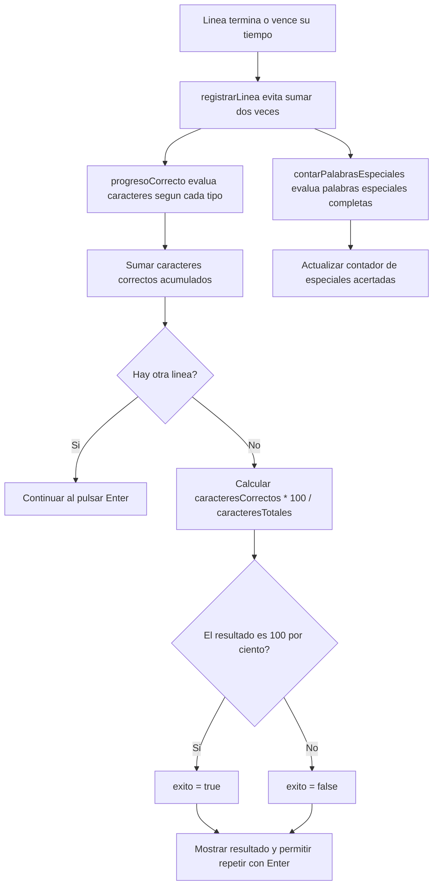

# Diagrama de flujo de Thanks, Typing

Este documento describe el recorrido que implementa actualmente el proyecto: desde que Java inicia hasta que el jugador termina o reinicia el juicio.

## 1. Inicio y carga del juicio

### Que valida el cargador

- Que el JSON se pueda interpretar y que exista al menos una linea.
- Que cada linea tenga `hablante`, `emocion`, `texto_original` y `tiempo_limite` positivo.
- Que cada marca `ROJO`, `VERDE` o `AMARILLO` se pueda convertir en un tramo.
- Que cada marca amarilla tenga alternativas no vacias y distinguibles mientras se escriben.
- Que `opciones_correctas` tenga una respuesta coincidente por cada marca amarilla.

`GuionJuicio` y `GuionJuicio.LineaGuion` son modelos de datos: Gson copia ahi las propiedades del JSON. `LineaDialogo` transforma cada cadena marcada en una secuencia de tramos que la pantalla y el teclado pueden procesar.

## 2. Conversion del texto del JSON a tramos

Un tramo guarda por separado `textoVisible` y `entrada`: por eso una palabra roja se ve como palabra, aunque para avanzar se reciban espacios. Los tramos amarillos conservan la lista de opciones, la correcta, las alternativas que todavia coinciden y el progreso de escritura.

## 3. Bucle de una linea: teclado, tiempo y avance

El temporizador consulta cada 100 ms, pero descuenta segundos usando `System.currentTimeMillis()`. Al completar la linea o agotarse el tiempo, si el JSON tiene `"break": true` el juego espera Enter. Si la propiedad falta o es `false`, avanza automaticamente. El ultimo dialogo muestra el resultado; Enter queda disponible para reiniciar.

## 4. Reglas que aplica `aplicarCaracter`

El color verde acepta que se escriba una palabra con mezcla de mayusculas y minusculas para poder seguir; al puntuar, cada palabra verde solo vale si se completo totalmente en mayusculas. En rojo cada posicion acepta un espacio o el caracter visible correspondiente, pero solo se cuentan como correctas las palabras cuyas posiciones se rellenaron todas con espacios. En amarillo se puede empezar cualquiera de las alternativas; solo la opcion indicada por `opciones_correctas` suma como correcta.

La propiedad global `tildes` del JSON controla las comparaciones normales, rojas, verdes y amarillas: con `true` se exige el mismo carácter acentuado; con `false` se ignoran tildes y diéresis. Las comparaciones siguen distinguiendo mayúsculas y minúsculas, salvo en verde, donde el avance convierte ambos caracteres a mayúsculas.

## 5. Puntaje y fin del juicio

El resultado actual usa el porcentaje de caracteres correctos y marca `exito` solo si llega al 100 %. El contador `ESPECIALES` se calcula aparte: cuenta palabras rojas rellenadas con espacios, palabras verdes completadas en mayusculas y opciones amarillas correctas.

## 6. Dibujo de cada fotograma

```mermaid
flowchart LR
    A[Swing llama paintComponent] --> B[Crear Graphics2D sobre el lienzo logico]
    B --> C[dibujarSala: fondo, estrado y personajes rectangulares]
    C --> D[dibujarActa: papel, hablante y barra de tiempo]
    D --> E[dibujarTramos: caracteres, colores, progreso y cursor]
    E --> F[Calcular escala uniforme para el panel]
    F --> G[Ampliar el lienzo con vecino mas cercano]
    G --> H[Mostrar la imagen pixelada en la ventana]
```

## Archivos y responsabilidades

| Archivo | Responsabilidad en el flujo |
| --- | --- |
| `Principal.java` | Crea la ventana Swing y coloca el panel del juego. |
| `PanelTribunal.java` | Coordina teclado, temporizador, lineas, puntaje y dibujo. |
| `CargadorGuion.java` | Lee y valida el JSON con Gson. |
| `GuionJuicio.java` | Define los modelos que reciben los datos JSON. |
| `LineaDialogo.java` | Convierte el texto marcado en tramos y administra su progreso. |
| `assets/dialogs/juicio_demostracion.json` | Contiene el guion que carga actualmente el panel. |

## Limites de la implementacion actual

- La escena y las personas se dibujan con rectangulos en `PanelTribunal`; todavia no se cargan sprites PNG.
- Los contadores de errores y sabotajes se calculan internamente, pero no se dibujan en pantalla.
- El campo `emocion` se carga desde el JSON, pero actualmente no cambia la expresion de los personajes.
- La precuela de cuatro imagenes, varios juicios seleccionables y una sentencia narrativa todavia no forman parte del flujo implementado.
- El juicio de demostracion se carga desde una ruta relativa a la carpeta raiz del proyecto.
